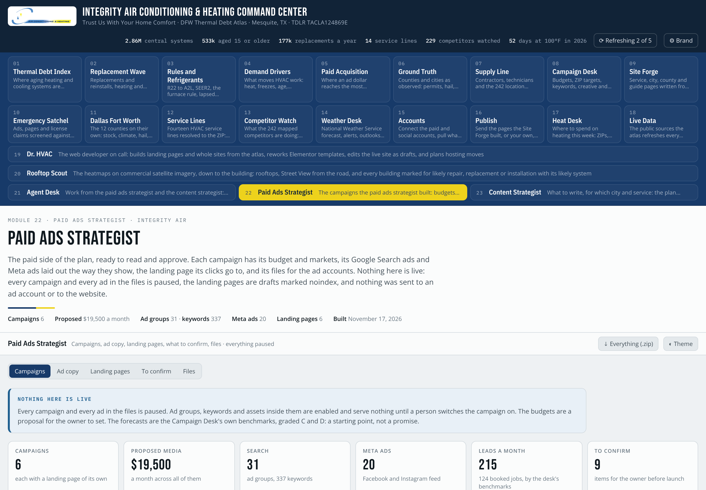

# Integrity Air Conditioning & Heating Command Center

One dashboard file: `Integrity_Air_Conditioning_and_Heating_Command_Center.html` (17.8 MB). Open it in a current
Chrome, Edge, Firefox or Safari. It works as a file; the map imagery, the brand fonts and the logo need a connection.

It is the DFW Thermal Debt Atlas, Build 6, with the Rooftop Scout 12 Scout Engine, plus the work of the two agents put
where each belongs. Made November 18, 2026.

| Module | What changed |
|---|---|
| 20 Rooftop Scout | The Scout Engine from Rooftop Scout 12 (the flicker and visual quality update). Carried over byte for byte. The engine's own report is `Scout_Engine_Flicker_and_Visual_Quality_Report.md`. |
| 21 Agent Desk | Holds eight hand-offs: the six heating campaigns, the 70 city pages with their sources linked, and the earlier trial run that was already in the file. A plan loads on the Campaign Desk from here, pages go to Publish from here. |
| 22 **Paid Ads Strategist** (new) | The six heating campaigns laid out to read and approve: budgets and markets, every Google Search ad and Meta ad the way it shows, the landing page each one sends its clicks to, what the owner has to confirm, and every file for the ad accounts. |
| 23 Content Strategist | The Pages view now holds both sets of rewrites: the 70 city pages and the 410 heating pages for every service area. The plan marks the 83 works those pages answer as built. |

Nothing in the file is live. Every campaign and every ad is paused, every page is a draft, and nothing is sent to an ad
account or to the website. A plan loads as a plan; pages land in Publish as drafts and go nowhere until a target is
chosen there.



## What is in it

**Paid ads** (from `heating-campaigns-for-review-v3`)

- 6 campaigns, $19,500 a month proposed, 31 ad groups, 337 keywords, 20 Meta ads, 2 Local Services profiles.
- 6 landing pages, each 100 in Dr. HVAC's page check, each marked noindex. Four link their Census sources.
- 9 items for the owner to confirm, and each campaign's own checks before launch.
- 50 campaign files (Google Ads Editor sheets, Meta and Local Services build sheets, keywords, creative, plans) and the
  25 page files for the web person. The module's zip hands all of it back.

**Page rewrites** (from `city-pages-for-review-with-sources` and `service-area-heating-pages-with-sources`)

- 70 city pages under `/service-area/`, as blueprints. 192 source links, 84 of them to Census tables.
- 410 heating pages: six heating services for each of the 70 cities, less the 10 the site already has. 266 where the
  dashboard finds demand, 114 low, 30 for the five cities with no figures on file. 697 Census links on 380 pages.
- The link blocks for the city pages, the manifest and the link sheet, as downloads.

## What was checked

`tools/check.mjs` opens the file in Chromium with the network closed and presses the buttons. 55 of 55 pass:

- every one of the 96 inline scripts parses, and the page raises no error in any of its 23 modules;
- each of the seven plans loads through the Campaign Desk's own Load, and the desk reckons the same leads and booked
  jobs the strategist did (for example 56 and 34 for heating repair);
- all 70 city pages compile in Publish with no blocking finding, and all 192 source links come through, each opening in
  another tab;
- all 410 heating pages and all 6 landing pages go into Publish, each with its own title, address, schema and styling;
- every ad group has 15 headlines and 4 descriptions inside Google's limits, with the license line pinned first, and no
  review score token is left unfilled;
- the zips the dashboard hands back hold the same bytes as the packages: 415 of 415 files for the heating pages, 83 of
  83 for the campaigns;
- Rooftop Scout opens and the Scout Engine starts: 35 shader programs link and none is refused.

```bash
node tools/check.mjs Integrity_Air_Conditioning_and_Heating_Command_Center.html
```

## What to know

- **Two files the campaign notes name are not here.** `report.json` and `handoff.json` did not come in the campaign
  folders. So the Agent Desk has no Claims tab for the six campaigns (the trial run has one). The owner's list is under
  Paid Ads Strategist, To confirm.
- **The pictures and the build sources were left out.** The review screenshots (`pictures/`) and the copy pools and
  scripts (`source/`) of the packages are not in the dashboard. The pages preview live instead.
- **The plan changed only where a page answers a work word for word.** 83 works (heating repair and furnace
  replacement by city) are now marked built. The other four heating services use keywords the plan does not carry,
  so the plan was left as the strategist worked it out.
- **The engine was checked on a software renderer.** That is the same limit the engine report states. Here it drew a
  street scene from FEMA buildings, Census streets and Esri imagery; OpenStreetMap did not answer from the build machine.
- **The contact form on the heating pages has not been tried on the live WordPress.** That is the content strategist's
  own note: publish one page first and send a test message.
- **Publish keeps pages only while the dashboard is open.** Send them again after a reload.
- The header and the title carry the new name. Exports still cite "DFW Thermal Debt Atlas, module N" as their source,
  because that is the model the figures come from.

## Building it again

`tools/build.mjs` makes the file from the Scout 12 dashboard and the three packages, unzipped. It reads the inputs as
text and runs nothing from them. Node 18 or newer, no dependencies.

```bash
node tools/build.mjs --base DFW_Thermal_Debt_Atlas_Build6_Rooftop_Scout_12_Scout_Engine.html --campaigns heating-campaigns --city city-pages --service service-area-heating-pages --out Integrity_Air_Conditioning_and_Heating_Command_Center.html
```

It stops, and writes nothing, if an anchor in the base file has moved, if a figure in a package does not agree with
another (a plan and its market sheet, the manifest and the page folder), or if a page would not come back out byte for
byte. The module sources are in `tools/src/`.
