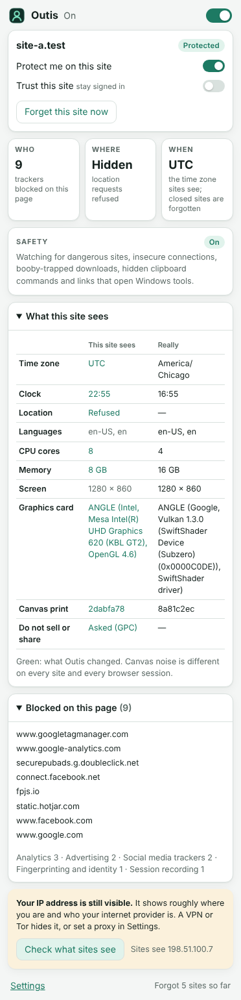

# Outis

*Sites see nobody, from nowhere, at no particular time.*

A Chrome extension that keeps websites, and the trackers inside them, from learning **who** you are, **where** you are and **when** you are there, and that stops the common ways malware gets in through the browser. (Outis is Greek for "nobody": the name Odysseus gave the Cyclops.) Everything runs inside your browser. Outis sends nothing anywhere.

## Install

1. Download [`Outis-chrome-extension.zip`](../Outis-chrome-extension.zip) from the repository root and unzip it. It holds one folder, `outis/`.
2. Open `chrome://extensions`, switch on **Developer mode** (top right), click **Load unpacked** and choose that `outis` folder.
3. Pin the Outis button to the toolbar. A welcome page opens with the two choices worth making on day one: whether sites see your real time zone, and whether sites are forgotten when you close them.

From a checkout of this repository, choose the `outis/` folder in step 2 instead. Keep the folder somewhere permanent: Chrome loads Outis from it every time it starts. Edge (`edge://extensions`) and Brave (`brave://extensions`) take the same steps; Outis is tested on Chrome.

## What it hides

| | What gives you away | What Outis does |
|---|---|---|
| **Who** | Tracking scripts, pixels and beacons | Blocks 228 tracker domains and addresses across analytics, ad networks, social media pixels, fingerprinting and identity-resolution services, and session recorders. Only on other sites' pages: the companies' own sites still open. Pages that wait on Google Tag Manager, Analytics or the Google ad tag get small stand-ins that send nothing but keep buttons and links working. |
| | Cookies that follow you between sites | Turns off third-party cookies and related-website sets. |
| | Tracking tags in links | Strips `utm_*`, `fbclid`, `gclid` and 86 other click and campaign identifiers before the page is requested. |
| | Your device's fingerprint | Adds invisible, per-site noise to canvas, WebGL and audio readouts, and reports a common graphics card, 8 cores, 8 GB, a window-sized screen, no exact OS version or hardware model, a typical connection, no installed voices, keyboard layout or local fonts, and a rounded disk quota. Strips the high-detail client hints from requests. |
| | Your consent | Sends Global Privacy Control, an opt-out of sale and sharing that California and several other states require many businesses to honor. |
| | Chrome's own ad features | Turns off ad topics, ad measurement, interest groups and hyperlink pings. |
| **Where** | The location API | Refuses every location request, or answers with a city you pick (a few hundred metres from its centre, different per site). |
| | Your time zone | Pages see UTC, or the time zone of the place you pick, in `Date`, `Intl` and `Temporal`. |
| | Your languages | Requests and scripts see `en-US`, so language settings don't point to a region. |
| | WebRTC | Video-call technology can't reveal your local addresses, or go around a proxy. |
| | The page you came from | A site you arrive at from another site isn't told where you came from. |
| | Your IP address | Can't be changed by an extension alone. Outis can send your traffic through a proxy or Tor, and shows you what address sites see. |
| **When** | Your clock | Sites see the time in UTC (or your chosen place), not your local time. |
| | Return visits | When the last tab of a site closes, its cookies and stored data are deleted after 15 seconds (or 1 or 10 minutes, or at the next browser start), so next time it can't tell you've been there. Sites you trust stay signed in. |
| | Your activity | Idle detection is refused, and the battery always reads full and charging, so its level can't link your visits. |

The fingerprint noise stays the same on one site for a whole browser session (so sites don't break or see it flicker), differs on every other site (so trackers can't match you across them), and changes when you restart the browser (so a site can't match you over time).

## What it stops

| Threat | What Outis does |
|---|---|
| Code slipped into pages on the network (public Wi-Fi, a hijacked router) | Opens every site over HTTPS. A site with no secure version gets a warning page first; you can continue over HTTP for that session. Your own network's devices (local addresses, `localhost`, single-word names) are left alone. |
| Known malware, scam-ad and cryptomining sites | Blocks 56 known addresses: cryptominers, the pop-up ad networks behind fake virus alerts, and throwaway tunnels attackers use to serve malware and collect stolen data. Opening one of these sites shows a warning page (you can still go on); inside other sites they don't load at all. |
| New dangerous sites and downloads | Keeps Chrome's Safe Browsing switched on: Google's list covers what no fixed list can. |
| Booby-trapped downloads | Deletes, before you can open them: programs a page builds itself (HTML smuggling), files disguised with a second extension (`invoice.pdf.exe`) or with reversed-text characters, "browser updates" from websites, and scripts and shortcuts that run when opened (`.js`, `.vbs`, `.hta`, `.lnk`, `.bat` and others). A warning page explains each one, and you can still download it on purpose. Sites can't start several downloads at once. |
| "Press Windows+R and paste" (ClickFix) and pastejacking | A command the page didn't show you never reaches your clipboard, a page can't swap what you copy for one, and sites can't read your clipboard. A command you can see on the page (a "copy this install command" button) still copies. |
| Links that run Windows tools | Blocks links and pop-ups to `search-ms:`, `ms-msdt:`, `ms-appinstaller:` and similar, which attackers use to run programs or show their own files as yours. Office "open in the app" links still work for Microsoft's own services. |
| Notification spam | Refuses "click Allow to prove you're not a robot" notification requests. Trusted sites can still ask. |
| Attacks on new browser features | On sites you haven't trusted: no WebGPU, and no keyboard lock (which fake virus-alert pages use to keep you from pressing Esc). Optionally no WebAssembly either. |
| A bad or hijacked extension | Lists what each of your other extensions is able to do, riskiest first, and lets you turn them off or remove them. Outis asks for permission to look only when you click, and you can give it back. |

Attacks nobody knows about yet ("zero-days") can't be listed in advance, so Outis narrows what one could reach and keeps you away from where they're found. Its settings page also walks you through the Chrome settings no extension may change: turning off the V8 optimizer (where most attacks on Chrome itself happen), Enhanced Safe Browsing, Chrome's own HTTPS-only mode, and staying updated.

## Using it

**The toolbar button** shows how many trackers it blocked on the page, or a red **!** when it stopped something dangerous. Its popup has:

- **Protect me on this site:** pause Outis on a site that breaks. A paused site sees your real details, gets no safety checks, isn't forgotten, and gets its permission prompts back.
- **Trust this site:** you stay signed in (it isn't forgotten when you close it), it may ask for notifications and to read the clipboard, and WebGPU and keyboard lock work there. The clipboard, link and download guards still apply.
- **Forget this site now:** deletes its cookies and data on the spot.
- **Who, where, when:** what is hidden right now.
- **Safety:** what was stopped on this page.
- **What this site sees:** the page's view of your time zone, clock, location, languages, cores, memory, screen, graphics card and canvas print, beside the real values.
- **Blocked on this page:** each blocked tracker host.
- **Check what sites see:** asks `check.torproject.org` once which IP address your requests come from.

**Settings** (right-click the button → Options) holds every switch above, the place picker, the proxy (with Tor presets), the zero-day checklist, the extension check, and the trusted and paused lists.



## What it can't do

- **Hide your IP address by itself.** Every site sees it, and it points to your area and internet provider. Use a VPN, Tor, or Outis's proxy setting.
- **Hide who you are from sites you sign in to.** Outis stops them following you elsewhere, not recognizing you on their own pages.
- **Hide the moment you visit.** A site always knows when your request reached it. Outis hides your clock, and forgetting stops it linking one visit to the next.
- **Reach background scripts.** Scripts that pages run in web workers are out of an extension's reach: they still see your real time zone and device details, and still have WebGPU and WebAssembly. Few trackers use them; some fingerprinting scripts and exploits could.
- **Catch every fingerprint.** Outis covers the signals trackers use most. Your window size, fonts measured from drawn text and many small details stay visible, so a determined fingerprinting service can still sometimes recognize a returning browser.
- **Block trackers served from the site itself,** or disguised as the site.
- **Block fraud checks.** Banks and stores run device checks at sign-in and checkout. Outis leaves those services alone, because blocking them gets you locked out. If a site still refuses you, pause Outis there.
- **Fix a flaw in Chrome.** A new attack on Chrome itself can still work; Outis narrows what it can reach, and the checklist and Chrome's updates do the rest.
- **Stop a hacked site you trust.** When a real site is broken into, the malware arrives from an address you trust. The clipboard, link and download guards still apply there, but the site itself isn't blocked.
- **Stop every redirect to a Windows tool.** The link guard catches clicks and pop-ups; a page that sends itself there by changing its own address still gets Chrome's "open this app?" question, so answer no.
- **Control Chrome and Google.** Chrome itself, a signed-in Google account with sync, and other extensions (beyond showing you what they can do) are outside its control.

## How Outis protects itself

- **Nothing remote.** No code is fetched from anywhere, nothing is sent anywhere, and the extension pages allow only their own scripts. Installed unpacked, Outis never updates itself, so it can't be swapped out by a hijacked update.
- **Pages can't steer it.** The page shield takes its settings and its seed before any page script runs and removes them from the page's reach. Its safety checks use their own copies of the browser's built-in functions, so a page can't blind them by replacing those functions. Messages from pages can only add a note to the popup.
- **The warning page can't be faked into letting anything through.** It explains only what Outis actually blocked in that tab, offers "continue" only then, refuses to work inside a frame, and sends no referrer. A site can't use it to get its own address allowed.
- **Least privilege.** The permission to see your other extensions is optional: asked for when you click and easy to give back. Switching Outis off or removing it hands every Chrome setting it changed back to you.

## Permissions, and why

| Permission | Used for |
|---|---|
| Read and change data on all sites (`<all_urls>`) | Running the page shield in every frame, rewriting request headers, reading tab addresses for the per-site switches |
| `declarativeNetRequest` | Blocking trackers and malware sites, cleaning links, HTTPS, the privacy headers, pausing sites |
| `scripting` | Registering the page shield; "What this site sees" |
| `privacy` | Third-party cookies, related-website sets, WebRTC, ad topics, ad measurement, link pings, Safe Browsing |
| `contentSettings` | Refusing location, notification, clipboard-reading and automatic-download requests |
| `downloads` | Stopping dangerous downloads |
| `browsingData`, `cookies` | Forgetting sites |
| `webRequest` | Counting blocked trackers, noticing a site with no HTTPS, signing in to a proxy |
| `webRequestAuthProvider` | Answering a proxy's sign-in request |
| `proxy` | The optional proxy |
| `storage`, `alarms` | Settings; forgetting sites on time |
| `management` (optional) | The extension check, only after you allow it |

## Privacy

Outis makes one network request of its own, "Check what sites see", and only when you click it. Settings live in `chrome.storage.local` (not synced), including a proxy password if you enter one. To forget a site, Outis keeps that site's addresses until it is forgotten; it keeps no list of which sites it forgot, only how many. What the safety checks stopped is kept per tab until the tab moves on or closes, in memory Chrome clears at restart.

## How it works

- `manifest.json`: Manifest V3. `background.js` is the service worker; `lib/` holds settings, sites, places, the tracker list (`trackers.js`), the malware list (`malware.js`), the safety rules (`safety.js`) and the request rules (`rules.js`).
- `rules/`: static request rules, generated from `lib/`. Dynamic rules (headers, referrer, HTTPS, paused sites) come from `lib/rules.js`; what you chose to open anyway lives in session rules, gone at restart.
- `inject/shield.js` runs in each page's own JavaScript world at `document_start`, before the page's scripts, in every frame (fresh `about:blank` frames included). A page script can't wait for storage, so its settings arrive as small generated files listed ahead of it (`inject/opt/`, `inject/places/`) and are deleted before the page runs. Trusted sites get a second registration with the hardening left out. `inject/key.js` runs just before it in the extension's isolated world: it leaves a per-site seed derived from the per-session id Chrome gives the extension's web-accessible files, and passes the shield's safety alerts to the background.
- `blocked.html` is the warning page; `surrogates/` are the stand-ins for Tag Manager, gtag, Analytics and the Google ad tag.

## Development

```bash
node tools/build.mjs
```

Regenerates `rules/`, `inject/opt/`, `inject/places/` and the suffix and safety lists in the shield. `--check` verifies them and the manifest without writing; `--zip` also writes `../Outis-chrome-extension.zip`.

```bash
node tests/run.mjs
```

52 unit tests, no packages: sites, settings, rules, the tracker and malware lists, the safety rules (ClickFix payloads against everyday developer commands, dangerous links, disguised downloads, extension risk), and the time zone engine against Node's own time zone data in ten zones.

```bash
node tests/e2e/run.mjs
```

164 checks in Chromium through Playwright, against local HTTPS and HTTP servers that answer for every host name. It needs Playwright, Chromium and `openssl`, and binds ports 443 and 80 (root, or `cap_net_bind_service`). It writes the screenshots in `tests/e2e/`. `node tools/icons.mjs` redraws the icons.

Tested on Chrome for Testing 153.
